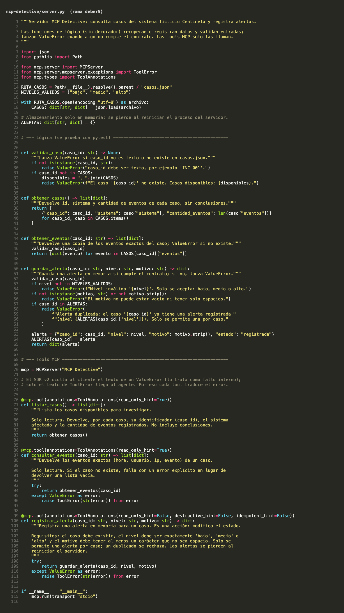
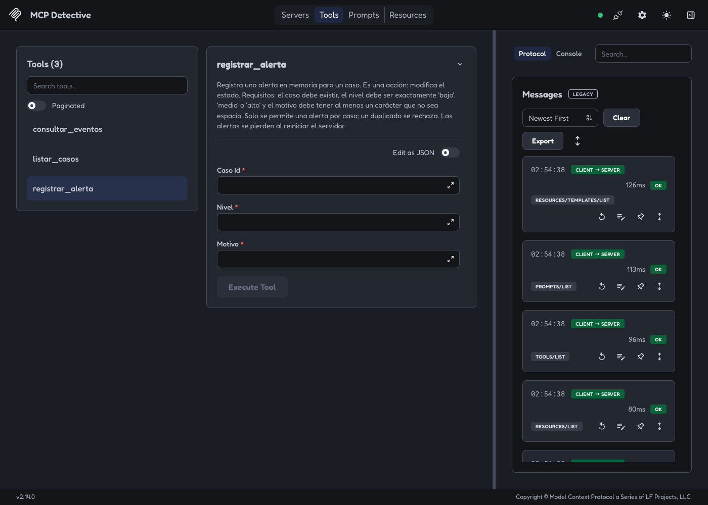
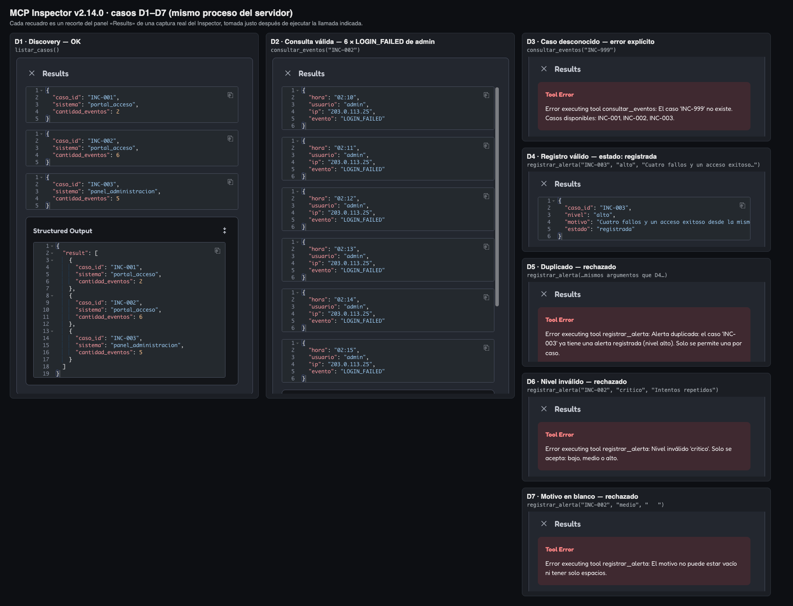
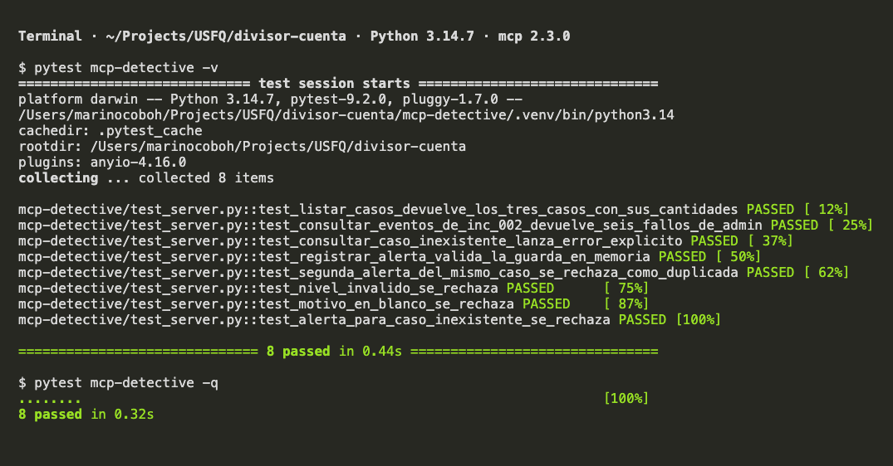
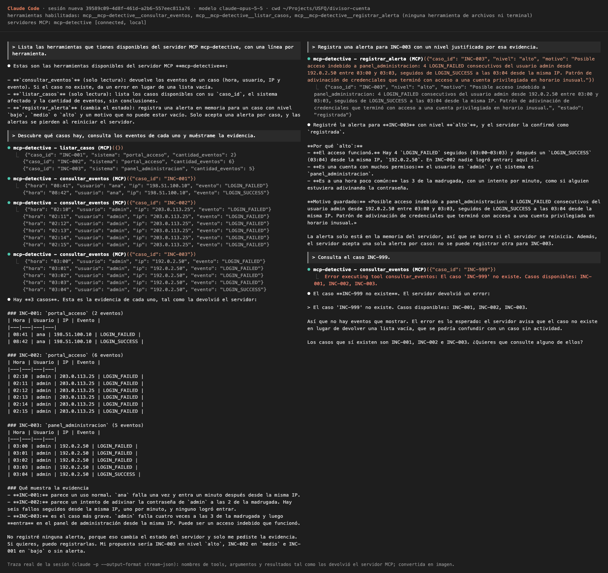

# Deber 5 — MCP Detective: respuestas

Programación Asistida de Aplicaciones · USFQ · Jose Martin Cobo

## Enlace de entrega

Pull request de `deber5`: https://github.com/jcobo-usfq/divisor-cuenta/pull/7. Repositorio público: https://github.com/jcobo-usfq/divisor-cuenta.

## Agente y entorno

- **Agente:** Claude Code 2.1.319 (modelo `claude-opus-5-5`). Lo usé para escribir el servidor y las pruebas, ejecutar el Inspector y redactar este archivo.
- **Python 3.14.7**, SDK `mcp` **2.3.0** (una sola versión, la v2), pytest 9.2.0, Node 26.12.1 y MCP Inspector 2.14.0.
- El SDK se instaló en un entorno virtual dentro de `mcp-detective/.venv`, que no se sube al repositorio.

## Qué se hizo

1. **Parte 1.** `mcp-detective/casos.json` tiene exactamente el contenido del enunciado. Lo comparé por programa con el bloque JSON del enunciado y es idéntico. `mcp-detective/server.py` tiene las tres tools. Cada tool llama a una función de lógica simple (`obtener_casos`, `obtener_eventos` y `guardar_alerta`), y esas funciones lanzan `ValueError`.
2. **Parte 2a.** En `mcp dev`, el Inspector descubrió las tres herramientas, y los casos D1–D7 dieron el resultado esperado (ver figuras).
3. **Parte 2b.** Hay 8 pruebas en `test_server.py` y las 8 pasan. Un *fixture* vacía `ALERTAS` antes y después de cada prueba, así que el orden no importa.
4. **Parte 2c.** En el mismo proceso, repetir D4 se rechazó como duplicado (D5). Después cerré el Inspector, comprobé que el proceso del servidor ya no existía (PID 71917) y abrí `mcp dev` otra vez (PID nuevo, 72420). La misma llamada de D4 volvió a responder `"estado": "registrada"`: la alerta anterior se había perdido.
5. **Parte 3.** Abrí una sesión nueva de Claude Code, sin el contexto de la sesión donde construí el servidor. En esa sesión **desactivé todas las herramientas propias del agente** (`--tools ""`: sin leer archivos, sin terminal y sin búsquedas). Solo quedaron las tres tools MCP. Así, el agente no tenía ninguna forma de abrir `casos.json`, y toda la evidencia salió de `listar_casos` y `consultar_eventos`.

### Un detalle del SDK v2 que encontré al verificar

En `mcp` 2.3.0, si una tool lanza un `ValueError` directamente, el SDK lo trata como un fallo interno. Al cliente solo le llega `Error executing tool consultar_eventos`, sin el mensaje. Con eso no se cumplía el requisito de un «error explícito». Lo confirmé leyendo `mcp/server/mcpserver/tools/base.py`. Por eso la lógica sigue lanzando `ValueError` (eso es lo que prueba pytest), y cada tool lo convierte en `ToolError` con el mismo texto. `ToolError` es la excepción del SDK cuyo mensaje sí llega al agente.

## Pregunta 1 — Arquitectura

- **LLM (Claude):** solo genera texto. Lee la descripción de las tools y *propone* cuál llamar y con qué argumentos. Después interpreta el resultado y redacta la respuesta. No ejecuta nada.
- **Harness / host (Claude Code):** maneja la conversación y los permisos. Decide si la llamada que propone el LLM se permite. Además, lanza el proceso del servidor según la configuración (`claude mcp add … -s local`).
- **Cliente MCP (dentro de Claude Code):** habla el protocolo con el servidor por `stdio`. Hace el *discovery* (`tools/list`), envía `tools/call` con los argumentos y devuelve el resultado al host, o el error con `isError`.
- **Servidor MCP (`server.py`):** recibe la llamada, valida los argumentos, lee `casos.json` o guarda la alerta en memoria, y responde.

**Quien ejecutó Python fue el servidor MCP**: el proceso `.venv/bin/python server.py`, que lanzó el host. El LLM nunca ejecutó código.

## Pregunta 2 — Evidencia

`INC-003` merece investigación por la combinación de varios hechos. En el sistema `panel_administracion`, la cuenta `admin` tuvo cuatro `LOGIN_FAILED` seguidos (03:00–03:03), un intento por minuto, todos desde la misma IP (`192.0.2.50`). A las 03:04 hubo un `LOGIN_SUCCESS` desde esa misma IP. Es el único caso en que una racha de fallos termina con un acceso, y ese acceso es a una cuenta con muchos permisos y en la madrugada. Por eso el nivel es `alto`.

Pero los logs no permiten afirmar con certeza que hubo una intrusión. Solo dicen *qué* pasó, no *quién* lo hizo. El mismo patrón puede ser el administrador real que olvidó la contraseña o tenía activado Bloq Mayús, un script con credenciales viejas, o una tarea programada. Además, no hay datos sobre lo que se hizo después del acceso, ni sobre MFA, la ubicación, el dispositivo o un cambio de contraseña. Por eso el motivo que guardó el agente dice «**posible** acceso indebido», y la alerta pide revisión humana en vez de declarar un compromiso. Un patrón sospechoso no demuestra un compromiso por sí solo.

## Pregunta 3 — Validación y seguridad

Quien rechaza `INC-999`, `nivel="critico"`, el motivo `"   "` y las alertas duplicadas es **el servidor**, en `validar_caso` y `guardar_alerta`. No lo rechaza el modelo. En la Parte 3, el error de `INC-999` lo generó `server.py`, y el agente solo lo transmitió sin inventar eventos.

No es seguro confiar solo en el modelo por varias razones:

- El LLM genera argumentos de forma probabilística. Puede escribir mal un identificador, inventar un nivel como «crítico» o llenar un campo con espacios.
- Al servidor no solo lo llama este agente. También lo llaman otros clientes, como el Inspector, otro host o un script, y el texto que entra (por ejemplo, un log) podría intentar manipular al modelo con una inyección de instrucciones.
- `registrar_alerta` cambia el estado, así que un error ahí deja datos incorrectos guardados.

Lo que mi servidor garantiza y el LLM no puede garantizar solo es esto: la tool sigue un **contrato determinista**. Hay un único conjunto de casos, un único conjunto de niveles y una sola alerta por caso. Si una llamada no cumple el contrato, siempre falla con un error explícito, y nunca devuelve algo que parezca una confirmación.

## Cómo comprobé que el agente estaba conectado

- `claude mcp get mcp-detective` muestra `Status: ✔ Connected` y `Scope: Local config`.
- Al iniciar, la sesión nueva reportó `mcp-detective [connected, local]`, y sus únicas herramientas eran `mcp__mcp-detective__listar_casos`, `mcp__mcp-detective__consultar_eventos` y `mcp__mcp-detective__registrar_alerta`.
- Cuando le pedí que listara sus herramientas, las describió a partir de los docstrings del servidor. En la traza (figura 5) se ve cada llamada con su argumento y el resultado que devolvió el servidor.

## Instrucciones breves

```bash
# 1. Instalar (desde la raíz del repositorio)
python3 -m venv mcp-detective/.venv
source mcp-detective/.venv/bin/activate
pip install "mcp[cli]>=2,<3" pytest
mcp version                           # MCP version 2.3.0

# 2. Pruebas
pytest mcp-detective -q

# 3. Inspector (necesita Node/npx en el PATH)
mcp dev mcp-detective/server.py       # abrir la URL que imprime y conectar

# 4. Conectar a Claude Code (ruta absoluta y el Python del venv)
claude mcp add mcp-detective -s local -- \
  "$PWD/mcp-detective/.venv/bin/python" "$PWD/mcp-detective/server.py"
claude mcp get mcp-detective          # Status: ✔ Connected
```

No hay tokens, contraseñas ni archivos `.env` en el repositorio. El token que imprime el Inspector es local y temporal, y no se guardó.

## Evidencias



*Figura 1: `mcp-detective/server.py` completo. Los decoradores `@mcp.tool()` están en las líneas 76, 86 y 99, y `casos.json` se carga desde `__file__` en la línea 14. Es el archivo real, con resaltado de sintaxis, convertido en imagen.*



*Figura 2: el MCP Inspector 2.14.0 conectado a «MCP Detective» por STDIO, con `Tools (3)` y el detalle de `registrar_alerta`. Es una captura real de la interfaz del Inspector, tomada con un Chrome sin interfaz gráfica.*



*Figura 3: los casos D1–D7, ejecutados en orden y en el mismo proceso del servidor. Cada recuadro es un recorte del panel «Results» de una captura real del Inspector.*



*Figura 4: la salida real de `pytest mcp-detective -v` y `-q` (8 passed), con sus colores, convertida en imagen.*



*Figura 5: la sesión nueva de Claude Code con los tres pedidos de la Parte 3, más el discovery. Se ve cada llamada (`listar_casos`, `consultar_eventos` ×3, `registrar_alerta` y `consultar_eventos("INC-999")`) con sus argumentos y el resultado del servidor. La traza real se obtuvo con `claude -p --output-format stream-json` y se convirtió en imagen con el formato de la interfaz.*
