# Deber 4 — Respuestas

Programación Asistida de Aplicaciones · USFQ · Jose Martin Cobo

## Enlace de entrega

Pull request de `deber4`: https://github.com/jcobo-usfq/divisor-cuenta/pull/6. Repositorio público: https://github.com/jcobo-usfq/divisor-cuenta.

## Herramientas

Usé Claude Code como agente de código, como indica el enunciado, para ejecutar el deber y redactar las respuestas. Los datos salen de las ejecuciones reales del repositorio. Las capturas que exigen sesión iniciada se reemplazaron por la salida real de la API de GitHub, y cada figura indica cuál es su origen.

## Qué se hizo

`main` solo tenía el proyecto base, así que el PR #1 unió el Deber 3 y la rama `sdd`, y movió las entregas anteriores a `entregas/`. Después, el PR #2 agregó el CI; el PR #3 falló a propósito y se corrigió; el PR #4 agregó el job `entrega`; el PR #5 aplicó lo aceptado de la revisión; y el PR #6 es esta entrega. `main` exige PR y el check `verificar`, también para administradores.

## Pregunta 1

El `ci.yml` final, tal como está en `main`:

```yaml
name: CI

permissions:
  contents: read

on:
  push:
    branches: [main]
  pull_request:

jobs:
  verificar:
    runs-on: ubuntu-latest
    timeout-minutes: 30
    steps:
      - uses: actions/checkout@v7
      - uses: subosito/flutter-action@1a449444c387b1966244ae4d4f8c696479add0b2 # v2
        with:
          channel: stable
      - run: flutter pub get
      - run: flutter analyze
      - run: flutter test
      - run: flutter build apk --debug

  entrega:
    needs: verificar
    if: github.event_name == 'push' && github.ref == 'refs/heads/main'
    runs-on: ubuntu-latest
    timeout-minutes: 30
    steps:
      - uses: actions/checkout@v7
      - uses: subosito/flutter-action@1a449444c387b1966244ae4d4f8c696479add0b2 # v2
        with:
          channel: stable
      - run: flutter pub get
      - run: flutter build apk --debug
      - uses: actions/upload-artifact@v7
        with:
          name: divisor-cuenta-debug-apk
          path: build/app/outputs/flutter-apk/app-debug.apk
          if-no-files-found: error
```

**analyze:** revisa el código sin ejecutarlo y falla si encuentra avisos o errores.

**test:** ejecuta las 35 pruebas y falla si alguna no da el resultado esperado.

**build:** compila el APK de depuración, lo que demuestra que el proyecto compila para Android en una máquina limpia.

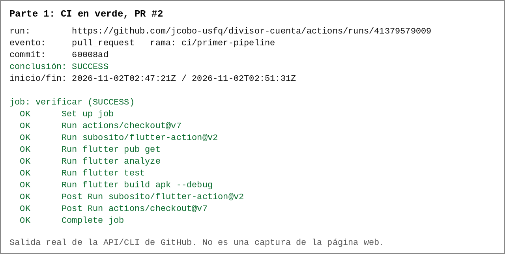

*Primer CI en verde (PR #2, Parte 1). Salida real de la API y del CLI de GitHub (gh), convertida en imagen. No es una captura de la página web, porque esa vista exige una sesión iniciada en el navegador.*

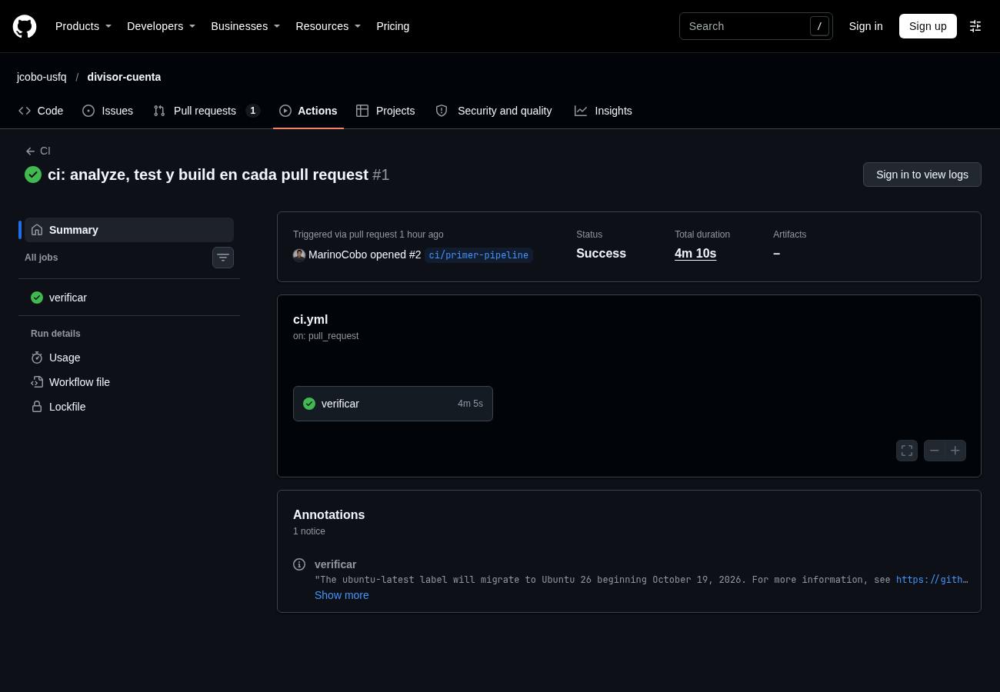

*Run del PR #2 en la pestaña Actions. Captura de la página pública de GitHub, vista sin iniciar sesión.*

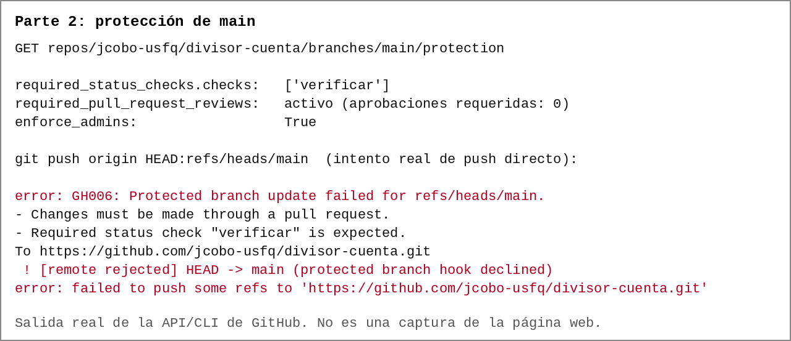

*Protección de main y push directo rechazado (Parte 2). Salida real de la API y del CLI de GitHub (gh), convertida en imagen. No es una captura de la página web, porque esa vista exige una sesión iniciada en el navegador.*

## Pregunta 2

La línea que dijo qué falló fue `Expected: a numeric value within <0.001> of <27.0>`, seguida de `Actual: <27.5>`. Encima aparece el nombre del escenario (`1. reparto normal`) y debajo el lugar (`test/division_test.dart 71:11`). El valor se cambió en `test/casos_de_prueba.dart`, pero el log apunta a `division_test.dart`, porque ahí está el `expect` que usa ese dato. El resumen fue `34 tests passed, 1 failed`.

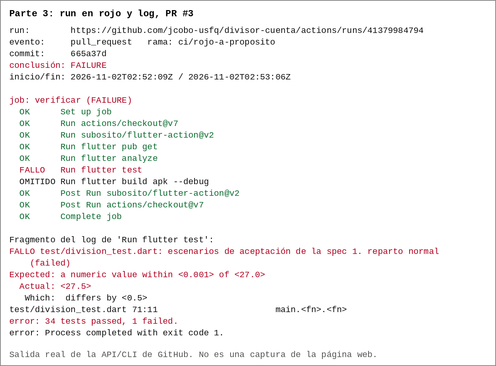

*Run en rojo y fragmento del log (PR #3, Parte 3). Salida real de la API y del CLI de GitHub (gh), convertida en imagen. No es una captura de la página web, porque esa vista exige una sesión iniciada en el navegador.*

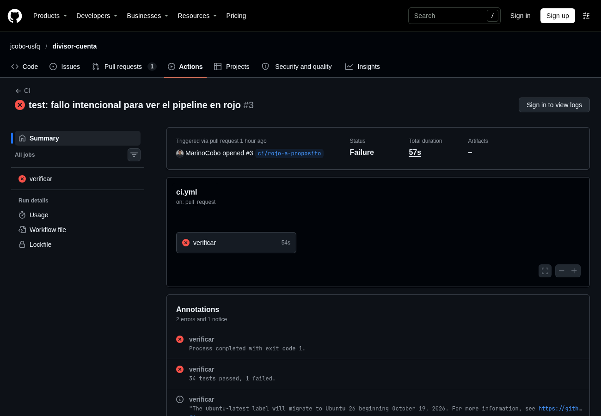

*Run en rojo en la pestaña Actions. Captura de la página pública de GitHub, vista sin iniciar sesión.*

## Pregunta 3

**Continuous integration:** cada cambio se integra y se verifica automáticamente (analyze, test y build). **Continuous delivery:** además, lo que pasa la verificación queda empaquetado y listo para entregarse, pero una persona decide cuándo publicarlo. **Continuous deployment:** lo que pasa se publica a producción sin aprobación humana.

Se implementó CI más una introducción a la entrega: el job `entrega` deja el APK como artifact solo tras pasar CI en `main`. No es deployment, porque nada se publica. Tampoco es una entrega completa lista para usuarios, porque es un APK de depuración, sin firma de release. Es lo que pide el deber y no requiere secretos.

## Pregunta 4

Con el check en rojo, GitHub reportó `mergeStateStatus: BLOCKED`, y un intento real de fusionar respondió `the base branch policy prohibits the merge`. Eso evita que un cambio con pruebas fallando llegue a `main`, que es de donde todos parten y de donde sale el APK. Sin la regla, el check sería solo un aviso que se puede ignorar.

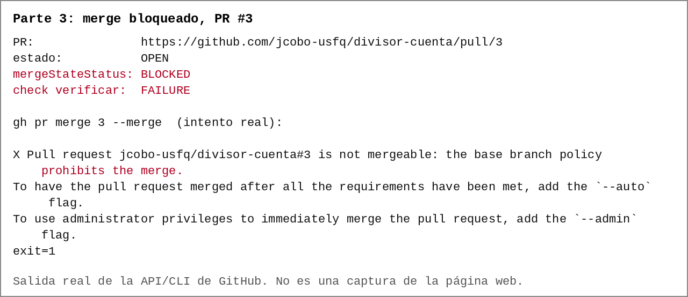

*Merge bloqueado con el check en rojo (PR #3). Salida real de la API y del CLI de GitHub (gh), convertida en imagen. No es una captura de la página web, porque esa vista exige una sesión iniciada en el navegador.*

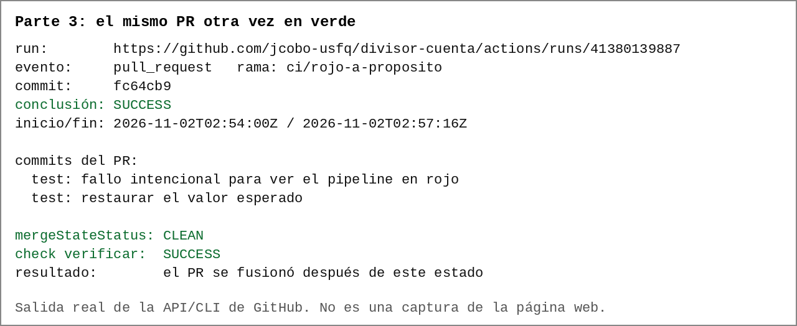

*El mismo PR de vuelta en verde y con el merge habilitado. Salida real de la API y del CLI de GitHub (gh), convertida en imagen. No es una captura de la página web, porque esa vista exige una sesión iniciada en el navegador.*

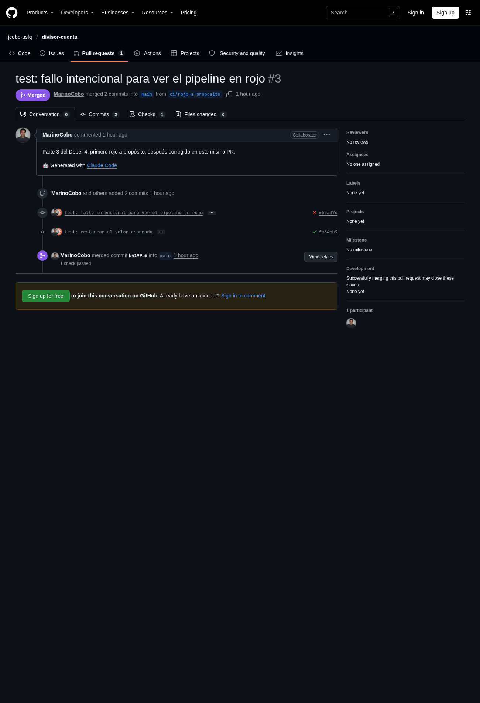

*Historial del PR #3. Captura de la página pública de GitHub, vista sin iniciar sesión.*

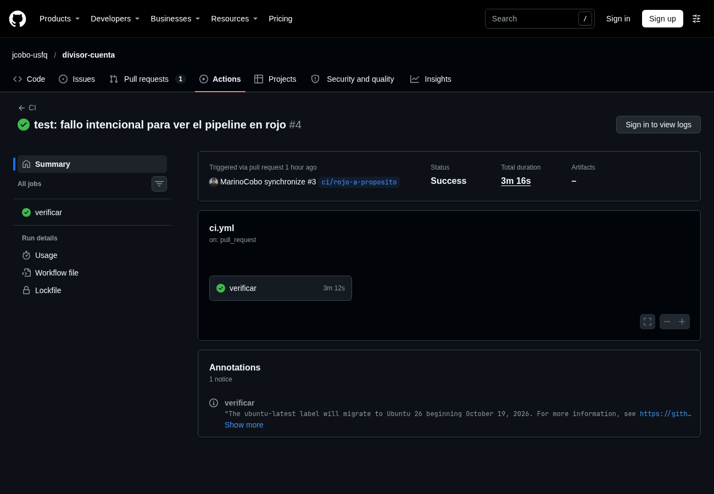

*Run en verde tras la corrección. Captura de la página pública de GitHub, vista sin iniciar sesión.*

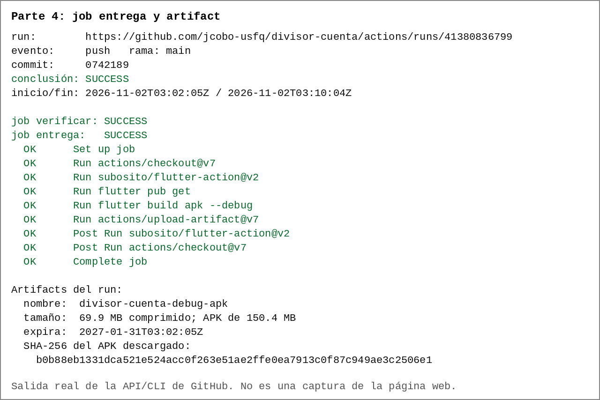

*Job entrega y artifact con el APK (Parte 4). Salida real de la API y del CLI de GitHub (gh), convertida en imagen. No es una captura de la página web, porque esa vista exige una sesión iniciada en el navegador.*

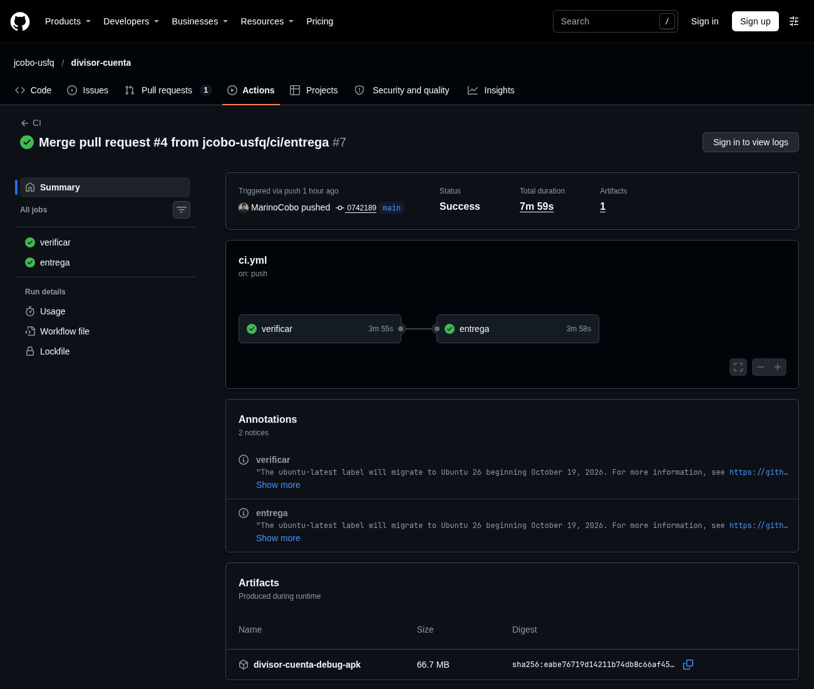

*Run de main con la sección Artifacts. Captura de la página pública de GitHub, vista sin iniciar sesión.*

## Pregunta 5

El agente revisó el `ci.yml` de la Parte 4. **Aceptadas** (aplicadas en el PR #5): `permissions: contents: read`, porque el workflow no necesita escribir en el repositorio; `timeout-minutes: 30`, para que un job colgado no corra hasta el límite de 6 horas; y fijar `subosito/flutter-action` por SHA, porque es de terceros y una etiqueta como `v2` se puede mover. Antes de fijarla se comprobó en la API de GitHub que el repositorio existe, que no está archivado y que `v2` apunta a `1a44944`.

**Rechazadas:** fijar la versión de Flutter y cambiar `ubuntu-latest` por una versión fija, porque el enunciado pide `stable` y `ubuntu-latest` (el riesgo se aceptó y queda anotado); agregar caché, porque mejora la velocidad pero no es un riesgo y añade complejidad; y agregar escáneres u otras acciones de terceros, porque serían dependencias sin verificar y el enunciado pide no agregar nada más. Tampoco se fijaron por SHA las `actions/*`, que son de GitHub; solo se comprobó que sus etiquetas `v7` existen.

## Pregunta 6

Un CI verde garantiza solo esto: para ese commit, en una máquina limpia y con esa versión de Flutter, las dependencias se resuelven, `flutter analyze` no da avisos, las 35 pruebas pasan y el APK compila. No garantiza que la app funcione en un teléfono, que la spec sea correcta ni que lo no probado esté bien.

**Ejemplo comprobado:** en una copia temporal se quitó `runApp` de `main()`, dejando solo `MaterialApp(...)`. La app abriría sin mostrar su pantalla, pero `flutter analyze` siguió con `No issues found!` y las pruebas con `+35: All tests passed!`, porque las pruebas arman la pantalla con `crearControlador()` y nunca ejecutan `main()`. El build no se corrió en esa copia, pero ese código es válido y no hay motivo para que no compile.

## Pregunta 7

No detectó ningún error real en el código: el único rojo fue el provocado a propósito. Lo que sí mostró y no se había visto antes: (1) el APK compila, algo que nunca se había comprobado en este computador, que no tiene Java; (2) el CI usó Flutter 3.47.9 y el local 3.47.7, así que `stable` puede cambiar sin que nadie toque el proyecto; (3) un aviso de GitHub de que `ubuntu-latest` migra a Ubuntu 26 desde el 19 de octubre de 2026, una fuente de fragilidad que no se ve en local.
